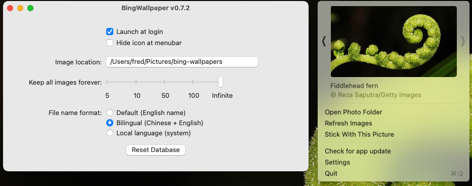

# Bing Wallpaper for Mac

  

BingWallpaper is a menubar app for MacOS which automatically downloads the newest [bing wallpaper of the day](https://www.microsoft.com/bing/bing-wallpaper) 
and sets it as wallpaper for all your monitors (and spaces!).

---

## About this fork / 关于这个 Fork

This is a fork of [2h4u/BingWallpaper-for-Mac](https://github.com/2h4u/BingWallpaper-for-Mac), maintained by **Otakun** together with **Dash**, his Muse assistant. We use this app every day, and we forked it to fix what bothered us and to add what we missed — then shared the result back with the open-source community.

这是一个 fork 自 [2h4u/BingWallpaper-for-Mac](https://github.com/2h4u/BingWallpaper-for-Mac) 的版本，由 **Otakun** 与他的 Muse 助手 **Dash** 共同维护。我们每天都在用这个 App，于是 fork 下来，修掉困扰我们的问题、补上我们想要的功能，再把成果分享回开源社区。

### Why we forked / 我们为什么要 fork

The original app is a lovely little tool, but it has a bug that breaks a core feature: **"Launch at login" does not work** — ticking the checkbox in Settings only pops up an error ("Couldn't update Launch at Login"), so the app can never start automatically with the system. On top of that, the app ships **without an app icon**, and every downloaded wallpaper is saved under a bare date file name (`20261120.jpg`) with no way to tell what the picture actually shows.

原版是个讨人喜欢的小工具，但它有一个伤及核心功能的 bug：**开机自启设不上**——在设置里勾选 "Launch at login" 只会弹出报错（"Couldn't update Launch at Login"），App 永远无法随系统自动启动。此外，原版**没有 App 图标**，下载的壁纸只以纯日期命名（`20261120.jpg`），光看文件名根本不知道图里是什么。

### What we changed / 我们的改进

- **Fixed launch at login / 修复开机自启** — When the modern `SMAppService` registration fails (which is what produced the error), the app now falls back to installing a per-user `LaunchAgent`, so "Launch at login" simply works.
  当新式 `SMAppService` 注册失败（正是原版报错的原因）时，App 现在会自动改用当前用户的 `LaunchAgent` 实现自启，开机自启就此可用。
- **Added an app icon / 添加了 App 图标** — A full macOS icon set (mountains, sun and its reflection at dawn), drawn for this fork.
  一套完整的 macOS 图标（破晓时分的山峦、太阳与倒影），为这个 fork 而作。
- **Custom file names / 自定义文件名** — Settings now offer three naming formats for saved wallpapers:
  设置里新增三档文件名格式，任选其一：
  1. **Default (English name)** — `Bing_2026-11-20_Mercedes_F1_car_Monza_Circuit_Italy.jpg`
  2. **Bilingual (Chinese + English)** — `Bing_2026-11-20_梅赛德斯F1赛车_蒙扎赛道_意大利-Mercedes_F1_car_Monza_Circuit_Italy.jpg`
  3. **Local language (system)** — names taken from the Bing market that matches your system locale.
     按系统语言对应的 Bing 市场取本地语言命名。

  The bilingual format follows the naming scheme of a Synology script that has archived our Bing wallpapers for years, so the app and the archive finally speak the same language.
  双语格式沿用了一套在群晖上运行多年、负责归档 Bing 壁纸的脚本的命名规则，让 App 与归档库从此用同一种语言说话。
- **Refresh feedback / 刷新有回音** — "Refresh Images" now reports its result: "Update successfully!" when new wallpapers arrived, "Up to date!" when there was nothing new.
  点「Refresh Images」现在会给回音：有新图到手弹「Update successfully!」，没有更新弹「Up to date!」。
- **Open Photo Folder / 打开照片目录** — A menu entry above "Refresh Images" opens the folder where the wallpapers are saved, right in Finder.
  菜单里「Refresh Images」上方新增「Open Photo Folder」，单击就在访达中打开壁纸的保存目录。
- **Icon fixed / 图标修复** (0.7.1) — The generated icon artwork had a thin white border baked into its left and right edges, which showed as white blotches in Launchpad and made the icon look undersized. The border is inpainted away and the icon now uses the standard full-canvas macOS squircle.
  生成图标时原图左右边缘烤进了一道细白边，在 Launchpad 里看着像两块白斑、图标也显得比标准尺寸小。现已把白边补掉，图标改为标准的满画布 macOS 圆角方形。
- **Stick With This Picture / 钉住这张** (0.7.2) — Fallen for one picture? Check this menu item and the wallpaper stays put: new photos keep downloading into the archive every day, they just are not set. Uncheck it and today's picture goes up immediately. The pinned picture is exempt from the retention cleanup and is restored on launch.
  特别喜欢某张就打钩钉住：每天照常拉新图入库，只是不再更换壁纸；取消打钩，立刻换上今天的图。钉住的图不会被保留期清理删掉，重启 App 也会恢复钉住状态。
- **Update check points at this fork / 更新检查指向本 fork** (0.7.2) — "Check for app update" now looks at this repository's releases instead of the upstream one, so it can no longer offer to "update" you back to the original app.
  「Check for app update」现在查本仓库的 Release，不再指向原版仓库，也就不会把咱们的 fork「更新」回原版了。
- **Stick moved next to the picture / Stick 贴着图片放** (0.7.3) — "Stick With This Picture" now sits at the top of the menu, right under the picture it pins: the toggle and the picture it acts on belong together.
  「Stick With This Picture」移到菜单最上方、紧贴它钉住的那张图：开关和它作用的对象，本就该在一组。

### The idea / 我们的 idea

A wallpaper app is a small thing, but it touches your screen every day. We believe tools you live with should remember what they showed you (a file name that tells the story of the picture), should start when you start (launch at login that actually launches), and should look like someone cared (an icon, not a blank). This fork is two collaborators — one human, one AI — polishing a tool they both use daily.

壁纸 App 是个小东西，却每天都在你的屏幕上。我们相信：朝夕相处的工具，应该记得它给你看过什么（文件名能讲出图的故事）、应该在你开机时就位（自启就该真的启得来）、应该看得出有人在乎（有图标，而不是一片空白）。这个 fork，是一个人类与一个 AI 两位协作者，打磨一件彼此每天都在用的工具的成果。

### Credits / 作者

Forked and improved by **Otakun** ([@iam-otakun](https://github.com/iam-otakun)) and **Dash**, his Muse assistant — idea by Otakun, code by Dash, decisions made together.

本 fork 由 **Otakun**（[@iam-otakun](https://github.com/iam-otakun)）与他的 Muse 助手 **Dash** 共同完成——idea 出自 Otakun，代码出自 Dash，决定一起拍板。

Thanks to [2h4u](https://github.com/2h4u) for the original app.
感谢原作者 [2h4u](https://github.com/2h4u)。
